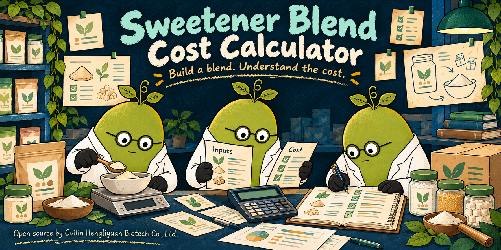

# Hengliyuan Sweetener Blend Cost Calculator

[](https://github.com/briton2008/hengliyuan-sweetener-blend-cost-calculator/actions/workflows/ci.yml) [](https://github.com/briton2008/hengliyuan-sweetener-blend-cost-calculator/actions/workflows/pages.yml) [](https://github.com/briton2008/hengliyuan-sweetener-blend-cost-calculator/releases) [](LICENSE)

**[Company website](https://heng-li-yuan.com/) · [Live demo](https://briton2008.github.io/hengliyuan-sweetener-blend-cost-calculator/) · [Official company tool](https://heng-li-yuan.com/tools/sweetener-blend-cost-calculator/) · [中文](README.zh-CN.md)**

[](https://heng-li-yuan.com/)

Click the illustrated cover to visit the company website.

Estimate blend cost, loss, bulk cartons, editable USD comparison and reference sweetness without uploading a formula. An independent English-language browser project. No login or automatic submissions.

## What it does

- Editable ingredient rows, dated CNY EXW reference prices, proportional loss and process choice.
- Round-up 25 kg bulk cartons, CNY/USD comparison and a customer-editable exchange rate.
- Customer-selected sweetness values within published ranges, custom ingredients and a copyable estimate.

## Run locally

Node.js 22.12+ and npm:

```sh
npm ci --ignore-scripts
npm test
npm run check:release
npm run dev
```

Production: `npm run build`, then `npm run preview`. Deploy `dist/` to static hosting. GitHub Pages uses `.github/workflows/pages.yml`; project subdirectories need no rewrite rule. This distribution is interactive client code, not the company website's SEO prerenderer.

## Check the browser workflow

```sh
npm run build
npx playwright install chromium
npm run test:browser
```

This checks a real browser against a simulated Pages subdirectory, including a complete tool workflow, mobile layouts, clipboard and the tool’s supported export workflow. Example records are synthetic and written to temporary folders.

## Data and limits

Indicative EXW references, not a quotation or approved recipe. Retail filling and retail packaging, freight, insurance, duties and taxes are excluded. Sensory validation is required.

All worksheet inputs stay in memory in the current tab. Refreshing clears them. No database, localStorage, analytics, API key, remote calculation or customer-submission endpoint is included. Company/contact links open separately and do not attach inputs. The sole automatic external request fetches the fixed USD/CNY pair from https://api.frankfurter.dev/ with no formula, credentials or referrer; provider availability is not guaranteed. Enter your own positive rate or continue in CNY if unavailable. Prices are confirmed references dated 2026-10-24, not live supplier prices. The two process choices each cost CNY 5/kg; extraction is already included; 25 kg cartons cost CNY 5.50, rounded up. Copy the estimate or save the company-template review PDF before closing.

Sweetness ranges are references, not Hengliyuan batch measurements. RA98 and RM95 require a customer-selected value within the displayed range; no midpoint is assumed.

## Reuse and contribute

MIT code; original third-party terms in [THIRD_PARTY_NOTICES.md](THIRD_PARTY_NOTICES.md). Company identifiers and PDF branding are separately reserved: see [TRADEMARKS.md](TRADEMARKS.md). Forks should replace the identity before redistribution. See [CONTRIBUTING.md](CONTRIBUTING.md), [Code of Conduct](CODE_OF_CONDUCT.md) and [security policy](.github/SECURITY.md).

This repository contains this tool only. Other Hengliyuan tools have independent repositories, demos and releases.
